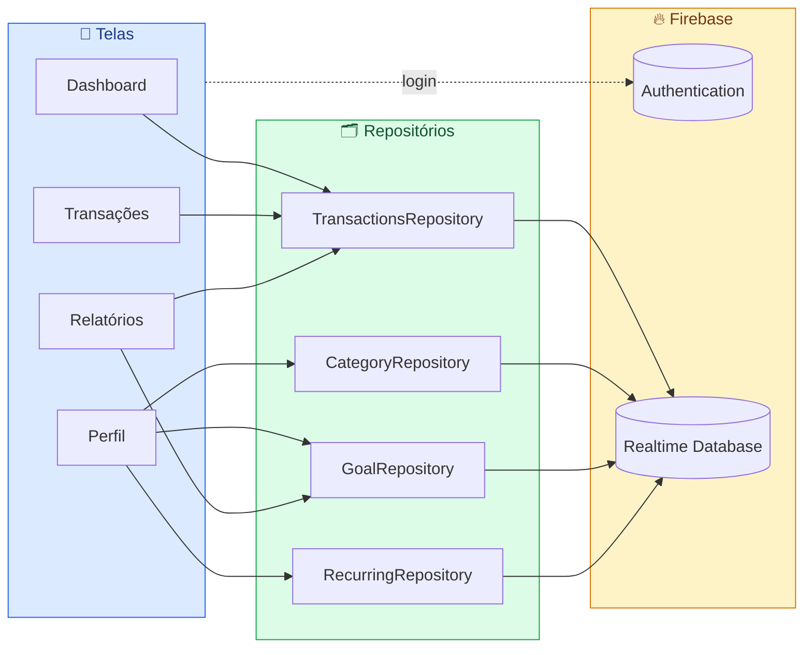

<div align="center">


<p align="center">
  
</p>

<br/>

[](https://kotlinlang.org)
[](https://developer.android.com)
[](https://firebase.google.com)
[](https://m3.material.io)


<br/>

**[📋 Funcionalidades](#-funcionalidades)** &nbsp;•&nbsp;
**[🧱 Arquitetura](#-arquitetura)** &nbsp;•&nbsp;
**[🛠️ Tecnologias](#️-tecnologias)** &nbsp;•&nbsp;
**[🚀 Como rodar](#-como-rodar)** &nbsp;•&nbsp;
**[👥 Autores](#-autores)**

</div>

<br/>

> [!NOTE]
> **Finlytics** é um app Android de controle financeiro pessoal desenvolvido como **Trabalho de Conclusão de Curso**.
> Ele transforma lançamentos do dia a dia em gráficos, metas e alertas, pra você entender pra onde vai cada real.

<br/>

## 📋 Funcionalidades

<table>
  <tr>
    <td width="50%" valign="top">

### 🏠 Dashboard
- Saudação personalizada e **saldo consolidado**
- Totais de receitas e despesas com **variação vs. mês anterior**
- Busca rápida entre os lançamentos
- Atalho pra análise por forma de pagamento

    </td>
    <td width="50%" valign="top">

### 🧾 Transações
- Receitas e despesas com **categoria, forma de pagamento, data e descrição**
- Edição e exclusão em um toque
- Filtros por **mês, tipo, categoria e pagamento**
- Valores no formato brasileiro (`R$ 1.234,56`)

    </td>
  </tr>
  <tr>
    <td width="50%" valign="top">

### 📊 Relatórios & Insights
- Receitas × despesas mês a mês (gráfico de barras)
- Gastos por categoria (gráfico de pizza)
- Análise por **forma de pagamento** com filtro de período
- Média diária, maior gasto, comparação mensal e **gasto por dia da semana**

    </td>
    <td width="50%" valign="top">

### 🎯 Metas
- **Limite de gasto** mensal, geral ou por categoria
- **Limite por forma de pagamento**: crédito, débito, Pix e qualquer outra que você criar
- **Meta de lucro** mensal (receitas − despesas)
- Barras de progresso coloridas: 🟢 tranquilo · 🟠 atenção · 🔴 estourou

    </td>
  </tr>
  <tr>
    <td width="50%" valign="top">

### 🔁 Recorrências
- Salário, aluguel, assinaturas e contas fixas
- **Lançamento automático** no dia configurado
- Dia 31 em mês curto? Lança no último dia do mês

    </td>
    <td width="50%" valign="top">

### 🎨 Personalização
- Categorias de receita e despesa **100% editáveis**
- Formas de pagamento personalizadas
- Tema **claro, escuro ou automático**
- 🔔 Alerta quando o saldo fica baixo ou negativo

    </td>
  </tr>
</table>

<details>
<summary><b>🔐 Autenticação</b></summary>
<br/>

- Cadastro e login com e-mail e senha via **Firebase Authentication**
- Recuperação de senha por e-mail
- Os dados de cada usuário ficam isolados em `users/{uid}` no banco

</details>

<br/>

## 🧱 Arquitetura

O app segue uma arquitetura simples em camadas: as telas (Activities/Fragments) conversam com **repositórios**, que encapsulam todo o acesso ao **Firebase Realtime Database**. As leituras são em tempo real, então qualquer alteração aparece na hora em todas as telas.



<details>
<summary><b>🗄️ Estrutura dos dados no Firebase</b></summary>
<br/>

```text
users/
└── {uid}/
    ├── transactions/      🧾 lançamentos (tipo, valor, categoria, pagamento, data)
    ├── categories/        🏷️ listas de receita, despesa e formas de pagamento
    ├── goals/             🎯 metas: gasto · pagamento · lucro
    ├── recurringConfig/   🔁 receitas e despesas fixas mensais
    └── balanceAdjustment  ⚖️ ajuste manual de saldo
```

</details>

<details>
<summary><b>📂 Estrutura do projeto</b></summary>
<br/>

```text
app/src/main/java/com/borgeiz/meutcc2026/
├── ⚙️ App.kt              # Application: aplica o tema salvo
├── 🧭 MainActivity.kt     # Navegação principal (bottom nav)
├── 🎬 SplashActivity.kt   # Abertura animada
├── 🔐 auth/               # Login, cadastro e recuperação de senha
├── 🏠 dashboard/          # Tela inicial: saldo, busca e atalhos
├── 🧾 transactions/       # Listagem, criação e edição de lançamentos
├── 📊 reports/            # Relatórios e análise por forma de pagamento
├── 👤 profile/            # Configurações, categorias, recorrências e metas
├── 🔔 notifications/      # Alertas de saldo
├── 🧩 adapter/            # Adapters de RecyclerView
├── 🗂️ data/               # Repositórios do Firebase
├── 📦 model/              # Transaction, Goal, RecurringItem...
└── 🔧 util/               # Gráficos, agregações, datas e dinheiro
```

</details>

<br/>

## 🛠️ Tecnologias

<div align="center">


</div>

<br/>

| | Camada | Stack |
|:-:|---|---|
| ⌨️ | **Linguagem** | Kotlin · JVM 21 |
| 🤖 | **Plataforma** | Android SDK — min 24 (Android 7.0) · target/compile 35 |
| 🔐 | **Autenticação** | Firebase Authentication |
| 🗄️ | **Banco de dados** | Firebase Realtime Database |
| 📈 | **Gráficos** | MPAndroidChart |
| 📱 | **Interface** | Material Components · Fragments · RecyclerView · SplashScreen API |
| 🔨 | **Build** | Gradle (Kotlin DSL) |

<br/>

## 🚀 Como rodar

> [!IMPORTANT]
> Você vai precisar do **Android Studio** (com JDK 21) e de um projeto no **Firebase**.

```bash
# 1. Clone o repositório
git clone https://github.com/borgeizdev/Finlytics.git
cd Finlytics
```

2. 🔥 Crie um projeto no [Firebase Console](https://console.firebase.google.com/) e habilite:
   - **Authentication** → provedor *E-mail/senha*
   - **Realtime Database**
3. 📄 Baixe o `google-services.json` e coloque em `app/`
4. 🔄 Abra no Android Studio e sincronize o Gradle
5. ▶️ Rode num emulador ou celular com **Android 7.0+**

```bash
# ou pela linha de comando
./gradlew installDebug
```

<br/>

## 👥 Autores

<div align="center">

Desenvolvido por **[borgeizdev](https://github.com/borgeizdev)**, **[leoalmeidahdev](https://github.com/leoalmeidahdev)** e **[puskadaa](https://github.com/puskadaa)**

<sub>Trabalho de Conclusão de Curso · 2026</sub>

</div>


